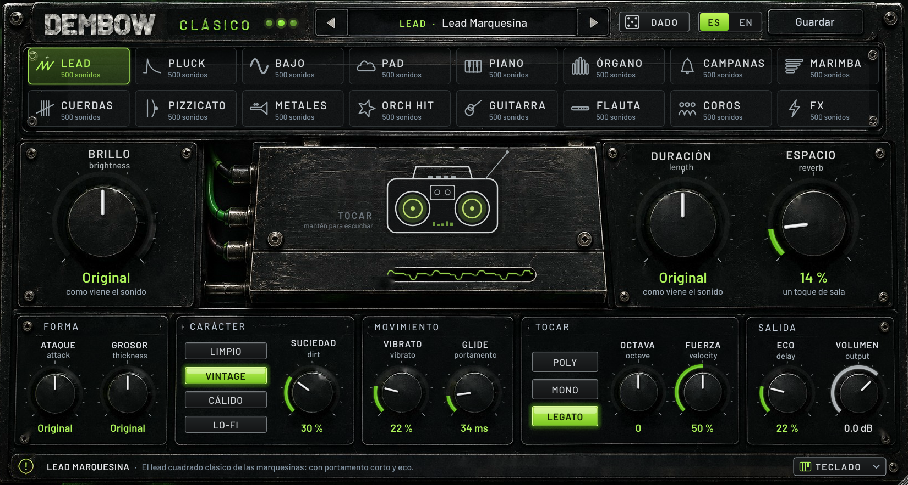

# Dembow Clásico

Un sintetizador **súper sencillo** para el reggaetón de la vieja escuela. Trae **8,000 sonidos** listos, 500 de cada tipo.
Eliges el tipo, eliges el sonido y lo ajustas con perillas que se entienden solas: **BRILLO**, **DURACIÓN**, **ESPACIO**, **SUCIEDAD**…
Si pasas el mouse sobre cualquier control, una barra de ayuda te explica qué hace, en español o en inglés.



Formatos: **VST3** y **AU** (macOS, Apple Silicon + Intel), **VST3** (Windows) y app **Standalone** para tocarlo sin DAW.
Es un instrumento: va en una pista de instrumento / MIDI, no en una de audio.

---

## Cómo se usa (en 10 segundos)

1. Arriba elige el **tipo** de sonido: Lead, Pluck, Bajo, Pad, Piano, Órgano, Campanas, Marimba, Cuerdas, Pizzicato, Metales, Orch hit, Guitarra, Flauta, Coros o FX.
2. Con **◀ ▶** pasa de sonido en sonido (500 por tipo). Si haces clic en el nombre se abre el **gestor**, con buscador, ★ favoritos y tus presets.
3. Ajusta las tres perillas grandes. En medio, BRILLO y DURACIÓN dejan el sonido como viene:
   - **BRILLO**: a la izquierda más oscuro, a la derecha más brillante.
   - **DURACIÓN**: a la izquierda notas cortitas, a la derecha largas.
   - **ESPACIO**: cuánta reverb.
4. ¿Quieres algo nuevo? **DADO** inventa un sonido al azar del tipo que tengas elegido.

Para escuchar sin teclado, mantén apretada la **grabadora** del centro o abre el **TECLADO** de abajo. El teclado se toca con el mouse o con las teclas de tu computadora.
Si haces doble clic en cualquier perilla, regresa a su valor inicial. La ventana se puede agrandar desde la esquina.

## Todos los controles

| Sección | Control | Qué hace |
|---|---|---|
| Arriba | ◀ ▶ · nombre · DADO · ES/EN · Guardar | Cambiar de sonido, abrir el gestor, inventar uno nuevo, cambiar el idioma, guardar el tuyo |
| Pantalla | 16 tipos | Cada uno trae 500 sonidos. Al regresar a un tipo, vuelve al último que usaste |
| Grandes | BRILLO · DURACIÓN · ESPACIO | Oscuro ↔ brillante, corto ↔ largo, seco ↔ sala grande |
| Forma | ATAQUE · GROSOR | Golpe ↔ entrada lenta; fino ↔ gordo y ancho (desafinación + chorus) |
| Carácter | LIMPIO · VINTAGE · CÁLIDO · LO-FI + SUCIEDAD | El color de época: tal cual, sampler de los 2000 (menos bits), cinta, casete viejo. SUCIEDAD dice cuánto |
| Movimiento | VIBRATO · GLIDE | Ondulación de afinación (también con la rueda de modulación) y portamento entre notas |
| Tocar | POLY · MONO · LEGATO · OCTAVA · FUERZA | Acordes o una nota a la vez, transponer ±2 octavas, cuánto importa qué tan duro tocas |
| Salida | ECO · VOLUMEN | Eco al ritmo de la canción (sigue el tempo del DAW) y volumen final |

Responde a: notas con velocidad, pitch bend (el rango depende del sonido), rueda de modulación (vibrato), pedal de sustain y "all notes off".
Todos los presets vienen **nivelados**: dentro de cada tipo suenan al mismo volumen.

## Los 8,000 presets

Cada tipo tiene **20 sonidos base** diseñados a mano. Cada uno viene en **25 versiones**: Original, Brillante, Oscuro, Vintage, Vintage sucio, Cálido, Lo-fi, Casete, Con eco, Eco largo, En sala, Lejano, Ancho, Fino, Corto, Largo, Suave, Duro, Octava arriba, Octava abajo, Con vibrato, Callejero, Discoteca, Noche y 2004. Algunas versiones cambian según el tipo; por ejemplo, los bajos traen «Mono» y «Con glide».
20 × 25 = 500 por tipo, 16 tipos = 8,000.

| Tipo | Sonidos base |
|---|---|
| Lead | Lead Marquesina · Lead Perreo · Lead Caserío · Silbato del Barrio · Lead Hoover Viejo · Square Mixtape · Lead Trompetica · Saw Underground · Lead Chiptune · Lead Sintonía · Lead Disco Duro · Supersaw Bellaqueo · Lead Ocarina Synth · Lead Corneta · Lead Gata · Lead Calentura · Lead Sirena · Lead Romántico · Lead Discoteca · Lead Malianteo |
| Pluck | Pluck Dembow · Pluck Marquesina · Pluck Caserío · Pluck Supersaw · Pluck Cristal · Pluck Kalimba Synth · Pluck Gota · Pluck Ácido · Pluck Arpegio · Pluck Madera · Pluck Calle · Pluck Chicle · Pluck Koto Callejero · Pluck Plástico · Pluck Doble · Pluck Campanita · Pluck Esquina · Pluck Rebote · Pluck Luna · Pluck Metálico |
| Bajo | Bajo Dembow · Bajo 808 Clásico · Bajo Marquesina · Bajo Saw Callejero · Bajo Sub Profundo · Bajo Tóxico · Bajo Goma · Bajo Pulso · Bajo Reese Viejo · Bajo Caja · Bajo Pluck · Bajo Eléctrico · Bajo Fretless · Bajo Analógico · Bajo Tumbao · Bajo Ácido Viejo · Bajo Hueco · Bajo Distorsión · Bajo Synth Pop · Bajo Sintético FM |
| Pad | Pad Marquesina · Pad Noche · Pad Cristalino · Pad Respira · Pad Romántico · Pad Vidrio · Pad Sweep 2004 · Pad Coro Synth · Pad Cálido · Pad Panorama · Pad Calle Lluviosa · Pad Órgano Suave · Pad Aire · Pad Metálico · Pad Estrellas · Pad Profundo · Pad Nostalgia · Pad Agua · Pad Celestial · Pad Tensión |
| Piano | Piano Romántico · Piano de Cola · Piano Vertical · Piano Cantina · Piano Algodón · Piano Dance · EP Clásico · EP Campana · EP Seda · EP Wurly · Piano Lofi · Piano Juguete · Piano Eléctrico Viejo · Clavinet Dembow · Piano Octavas · Piano Nocturno · EP Trémolo · Piano Synth 80s · Clavecín Callejero · Piano con Colchón |
| Órgano | Órgano Gospel · Órgano Lleno · Órgano Dulce · Órgano Iglesia · Órgano Rock · Órgano Hueco · Órgano Cine · Acordeón Viejo · Órgano Bubble · Órgano Combo · Órgano Transistor · Órgano Percusivo · Melódica Callejera · Armónica Synth · Órgano Leslie Lento · Órgano Casete · Bandoneón · Órgano FM · Órgano Flauta · Órgano Alto |
| Campanas | Campana Iglesia · Campana Tubular · Caja de Música · Glockenspiel · Celesta · Campanita FM · Campana Cristal · Campana de Viento · Campana Digital 80s · Campana Profunda · Campana Lofi · Triangulito · Campana Templo · Campana Pluck · Campanas Hielo · Gamelán · Campana Sintética · Campanas Ensueño · Campana Doble · Carillón |
| Marimba | Marimba Clásica · Marimba Terciopelo · Marimba Tropical · Vibráfono · Vibráfono Motor · Xilófono · Kalimba · Steel Pan Caribe · Steel Pan Doble · Marimba FM 80s · Balafón · Marimba Grave · Kalimba Oscura · Marimba Synth · Mallet Madera · Vibes Nocturno · Marimba Dembow · Steel Drum Synth · Glock Marimba · Kalimba Agua |
| Cuerdas | Cuerdas Orquesta · Cuerdas Romántico · Cuerdas 80s · Cuerdas Staccato · Violín Solo · Cello · Cuerdas Cine · Cuerdas Tensión · Cuerdas Altas · Cuerdas Graves · Cuerdas Cálidas · Cuerdas Spiccato · Cuerdas Pulse · Cuerdas Swell · Cuerdas Marcato · Cuerdas con Coro · Cuerdas Viejas · Cuerdas Octavas · Cuerdas Terciopelo · Cuerdas Disco |
| Pizzicato | Pizzicato Orquesta · Pizzicato Solo · Pizzicato Cálido · Pizzicato Seco · Pizzicato Synth · Pizzicato Grave · Pizzicato Agudo · Arpa · Arpa Cristal · Pizzicato Doble · Pizzicato Cine · Pizzicato Clásico · Pizzicato Juguete · Pizzicato Madera · Pizzicato Pop · Pizzicato Romántico · Pizzicato Rebote · Pizzicato Seda · Pizzicato Metal · Pizzicato Ensamble |
| Metales | Metales Stab · Metales Sección · Trompeta Solo · Trombón · Metales 80s · Metales FM · Corno Francés · Trompetas Fiesta · Saxofón Synth · Metales Swell · Metales Golpe · Metales Graves · Tuba Synth · Metales Sucios · Fanfarria · Metales Callejeros · Metales Bend · Metales Algodón · Metales Octavas · Metales Sintéticos |
| Orch hit | Orch Hit Clásico · Orch Hit Mayor · Orch Hit Menor · Orch Hit 8 Bits · Orch Hit Cine · Orch Hit Seco · Orch Hit Coro · Orch Hit Sucio · Orch Hit Vidrio · Orch Hit Grave · Orch Hit Doble · Orch Hit Quinta · Orch Hit Metales · Orch Hit Cuerdas · Orch Hit Timbal · Orch Hit Láser · Orch Hit Retro · Orch Hit Suspendido · Orch Hit Disco · Orch Hit Épico |
| Guitarra | Nylon Romántica · Nylon Clara · Requinto Bachata · Guitarra Acústica · Guitarra Eléctrica Limpia · Guitarra Muteada · Mandolina · Guitarra 12 Cuerdas · Guitarra Funk · Guitarra Jazz · Guitarra Lofi · Cuatro Puertorriqueño · Tres Cubano · Guitarra Española · Guitarra Eco · Guitarra Susurro · Guitarra Armónicos · Guitarra Trémolo · Guitarra Fiesta · Guitarra Nocturna |
| Flauta | Flauta Andina · Zampoña · Ocarina · Flauta Traversa · Piccolo · Silbido · Flauta Dulce · Clarinete · Flauta Synth · Zampoña 2004 · Ocarina Grave · Flauta Aire · Silbato Lead · Flauta Eco · Flauta Bambú · Flauta Nocturna · Pífano · Ocarina Synth · Flautas Dobles · Flauta Cristal |
| Coros | Coro Aah · Coro Ooh · Coro Grave · Coro Soprano · Voz Sintética · Coro Iglesia · Coro Eeh · Coro Mmm · Coro Stab · Coro Ensueño · Coro Robot · Coro Mixto · Coro Susurro · Coro Sombra · Coro Vintage · Coro Lento · Coro Aire · Coro Cine · Coro Pop · Coro Oh |
| FX | Bocina de Fiesta · Sirena Policía · Láser · Zap · Riser Ruido · Caída Libre · Viento · Rebobinar · Impacto · Burbujas · Alarma · OVNI · Explosión 8 Bits · Barrido · Disparo · Ola · Radio Perdida · Pitido · Subida Supersaw · Golpe Reverso |

Tus presets se guardan en `Documentos/Dembow Clasico/Presets` (archivos `.dmbpreset`) y aparecen en «Mis presets».

## Cómo suena por dentro

Cinco motores, todos generados en tiempo real (no usa samples):

- **Analógico**: osciladores sin aliasing, unísono de hasta 7 voces, segundo oscilador, sub y ruido.
- **FM**: 4 operadores, para pianos eléctricos, campanas y metales de los 80.
- **Cuerda pulsada**: Karplus-Strong afinado, para guitarras, pizzicatos, arpas y plucks.
- **Modal**: parciales con su propio decaimiento, para pianos, marimbas, campanas, órganos y flautas.
- **Voz**: ensamble con formantes (A E I O U), para coros.

Después del motor pasa por filtro con envolvente, LFO, vibrato y glide. Luego vienen los efectos: carácter (bits / cinta / casete / saturación), chorus, eco sincronizado y reverb. Al final, un limitador suave.
Usa unos 0.3 a 1.4 % de CPU por nota en una computadora modesta y tiene 16 voces de polifonía.

## Compilar

Requiere CMake 3.22+ y un compilador con C++20. JUCE 8 se descarga solo.

```bash
cmake -S . -B build -DCMAKE_BUILD_TYPE=Release
cmake --build build --config Release
```

Pruebas (sonido, los 8,000 presets, MIDI, estado, interfaz) y capturas:

```bash
cmake -S . -B build -DDMB_BUILD_TESTS=ON
cmake --build build --target DembowTests
./build/DembowTests_artefacts/Release/DembowTests test
./build/DembowTests_artefacts/Release/DembowTests host "build/DembowClasico_artefacts/Release/VST3/Dembow Clasico.vst3"
./build/DembowTests_artefacts/Release/DembowTests snapshot captura.png 0 1.0 "play keys"
```

En `lab/` está el laboratorio de sonido. Ahí se diseñan los sonidos, se revisa la afinación y se genera `Source/presets/Levels.inc`, la tabla que nivela el volumen de los 8,000 presets (`DmbLab levels`). Si cambias un sonido o el motor, vuelve a generarla.

El instalador de macOS (.pkg y .dmg) y el .zip de Windows los arma GitHub Actions (`.github/workflows/build.yml`). Las pruebas `auval` y `pluginval` corren en cada compilación.
El nombre, el fabricante y el identificador salen de `product.env`.

## Licencia

© ECO Audio. Todos los derechos reservados. Ver `legal/EULA.md`. Usa JUCE bajo la licencia JUCE 8.
